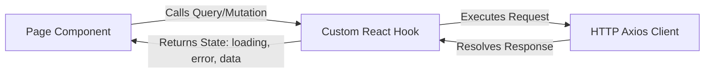

# Generic Full-Stack Frontend Playbook: Onboarding & Development Blueprint

This document is a project-agnostic, universal blueprint for developers and AI agents tasked with building the frontend client of any full-stack web application once the database and backend API layers are already complete.

Follow these systematic phases, architectural patterns, and development workflows to implement UI views, connect data layers, manage access rules, and ensure high code quality.

> [!IMPORTANT]
> **STRICT VISUAL COMPLIANCE MANDATE**: Before building, updating, or modifying any user interface, visual style, layout, custom component, or frontend element, developers and AI agents **MUST** read and strictly adhere to the design system tokens, color palettes, typography mappings, and layout guidelines specified in the [DESIGN.md](file:///d:/odooksv/.github/agents/DESIGN.md) specification. There are absolutely no exceptions to this rule.
>
> **STRICT PLAYBOOK COMPLIANCE MANDATE**: When building, updating, or integrating any feature (including folders, pages, hooks, services, contexts, styles, routing, and tests), developers and AI agents **MUST** strictly follow each and every aspect, rule, and workflow outlined in this [FRONTEND_AGENT_PLAYBOOK.md]. Adhering to modularity, reusability patterns, and code safety standards is mandatory.

---

## 1. Phase 1: Deep Backend & Contract Auditing
Before writing any frontend code, perform a deep audit of the backend repository to construct the API contract maps.

### 🔍 Audit Checklist
1. **Map the Routing Layer**: Locate all backend router directories to compile a list of REST endpoints (e.g., `GET /api/resource`, `POST /api/resource`, `DELETE /api/resource/:id`).
2. **Audit Request Schemas**: Read request body validators (e.g. Joi, Zod) on the backend to determine required request body keys, URL route parameters, search query parameters, data types, and constraint formats.
3. **Verify Auth Gates & Session Delivery**: Identify which routes are guarded by authentication middlewares. Check whether session keys are passed via HTTP headers (e.g., `Authorization: Bearer <token>`) or HttpOnly cookie sessions.
4. **Identify Roles and Permissions**: Audit database role enums or auth rules to map the system's role-based access control (RBAC) levels (e.g. levels like administrator, manager, employee, client).

---

## 2. Phase 2: Feature-Based Modular Architecture
To keep the codebase scalable, maintainable, and prevent merge conflicts, organize the frontend application using a **feature-based modular structure**. Group all related code (pages, styles, services, hooks, utilities) by feature domain.

### 📁 Feature Scaffolding Folder Structure
When creating a new feature section, always structure it with dedicated testing, asset, context, and schema directories to maintain self-contained modular units. This makes deleting, refactoring, or testing features extremely clean.
```
client/src/features/[featureName]/
├── pages/                    # Page (Container/Smart) components mapped to routes
│   └── [PageName].jsx
├── components/               # Custom presentational visual components unique to this feature
│   └── [SubComponent].jsx
├── hooks/                    # Custom React hooks scoped strictly to this feature
│   └── use[FeatureName].js
├── services/                 # API service request definitions (Axios/fetch client methods)
│   └── [featureName].api.js
├── context/                  # Internal React Context / local state managers for the feature
│   └── [featureName].context.jsx
├── schemas/                  # Zod, Yup, or Joi form schema validations
│   └── [featureName].schemas.js
├── styles/                   # Stylesheets scoped strictly to this feature (BEM files)
│   └── [featureName].scss
├── assets/                   # Feature-specific media assets (custom SVGs, graphics)
│   └── [graphicName].svg
├── tests/                    # Testing suites for feature pages, components, and hooks
│   ├── [PageName].test.jsx
│   └── use[FeatureName].test.js
└── index.js                  # Barrel export file (exposes pages, components, and hooks publicly)
```

### 🗂️ Global Application Architecture (`client/src/` Layout)
To ensure components are placed correctly and global configs are separated from domain features, organize the source directory using this hierarchy:
```
client/src/
├── assets/                   # Global media assets, icons, fonts, brand logos
├── components/               # Global presentational UI components (Buttons, Cards, Inputs)
│   └── index.js              # Export registry for global UI components
├── features/                 # Modular feature domains
│   ├── shared/               # Shared feature: contains global system utilities and base designs
│   │   ├── components/       # Complex shared widgets (Sidebar, Navbar, Tables, Modals)
│   │   ├── hooks/            # Reusable utility hooks (useCrud, useLocalStorage, useTheme)
│   │   ├── services/         # Shared API instances, Axios configurations, interceptors
│   │   ├── styles/           # Global Sass style variables, reset rules, mixins map
│   │   └── utils/            # Global helpers (formatting, dates, auth token extractors)
│   └── [featureName]/        # Feature directories structured as shown above
├── routes/                   # Routing registries and navigation components
│   ├── app.routes.jsx        # Master routing configuration path maps
│   └── ProtectedRoute.jsx    # Auth route guard components
├── App.jsx                   # Application bootstrap (mounting routing context & global contexts)
├── main.jsx                  # React DOM mount entrypoint
└── index.scss                # Global master styling sheet loading imports
```

### 🚫 Rules of Strict Modularity & Reusability
To maintain strict modular isolation and prevent structural dependencies, the frontend developer/agent must follow these rules:

1. **Strict Feature Isolation (Zero Internals Imports)**:
   * A component in one feature (e.g. `features/[featureNameA]`) must **never** import directly from the inner folders of another feature (e.g. `import [SubComponent] from '../[featureNameB]/components/[SubComponent]'`). Direct imports of file internals across features are strictly forbidden.
2. **The Barrel Export Interface**:
   * If Feature A must utilize a component or utility from Feature B, it can *only* import it via Feature B's public barrel export index (e.g. `features/[featureNameB]/index.js`). Feature index files must explicitly export only what is intended to be public.
3. **The Shared Refactoring Rule**:
   * If any component, hook, utility, or SCSS style is shared across **two or more unrelated feature domains**, it must be refactored out of the feature folders and placed in the central shared feature directory (`client/src/features/shared/`).
4. **Separation of Presentational (Dumb) vs Container (Smart) Components**:
   * **Presentational components** (files inside `features/[featureName]/components/` or `shared/components/`): Must be stateless and have **no direct API connections** or side-effects. They receive data solely via props, use callback functions for triggers, and are designed to be generic and reusable.
   * **Container components** (files inside `features/[featureName]/pages/`): Act as smart managers. They bind API hooks, coordinate search filters, handle local parameters, launch modals, and pass state down to dumb components.

---


## 3. Phase 3: Base API, Dev Proxy & Root Entry Setup
Establish a secure, clean network communication layer and initialize standard root configurations.

### A. Development Dev Server Proxy
Configure the local server config (e.g. `vite.config.js`) to intercept frontend API calls (e.g., starting with `/api`) and forward them transparently to the backend port:
```javascript
// Example proxy configuration utilizing environment variables
import { defineConfig, loadEnv } from 'vite';

export default defineConfig(({ mode }) => {
  // Load env variables from the current directory
  const env = loadEnv(mode, process.cwd(), '');
  const targetUrl = env.VITE_BACKEND_URL || `http://localhost:${env.VITE_BACKEND_PORT || '<BACKEND_PORT>'}`;

  return {
    server: {
      port: parseInt(env.PORT || '<CLIENT_PORT>', 10),
      proxy: {
        '/api': {
          target: targetUrl,
          changeOrigin: true,
          secure: false,
        },
      },
    },
  };
});
```

### B. Shared HTTP Client
Configure a unified HTTP client (e.g. using Axios) that manages base configurations, credential propagation, headers, and response interceptors.
```javascript
import axios from 'axios';

const api = axios.create({
    baseURL: import.meta.env.DEV 
        ? (import.meta.env.VITE_API_PREFIX || '/api') 
        : (import.meta.env.VITE_API_URL || ''),
    withCredentials: true, // Propagates session cookies on cross-origin requests
});

// Configure default authorization headers if using Token-based Auth
api.interceptors.request.use((config) => {
    const tokenKey = import.meta.env.VITE_AUTH_TOKEN_KEY || '<TOKEN_KEY>';
    const token = localStorage.getItem(tokenKey);
    if (token) {
        config.headers.Authorization = `Bearer ${token}`;
    }
    return config;
});

export default api;
```

### C. Root Entrypoint Boilerplate
Set up standard entry files to mount the React tree and provide global routing contexts.

#### `client/src/main.jsx`
```javascript
import React from 'react';
import ReactDOM from 'react-dom/client';
import App from './App';
import './index.scss'; // Global styling variables loading sheet

ReactDOM.createRoot(document.getElementById('root')).render(
  <React.StrictMode>
    <App />
  </React.StrictMode>
);
```

#### `client/src/App.jsx`
```javascript
import React from 'react';
import { RouterProvider } from 'react-router-dom';
import { router } from './app.routes';
import { [GlobalProvider] } from './context/[GlobalProvider]'; // Wrap core auth, themes, etc.

const App = () => {
  return (
    <[GlobalProvider]>
      <RouterProvider router={router} />
    </[GlobalProvider]>
  );
};

export default App;
```

---

## 4. Phase 4: Feature Implementation Scaffolding Workflow
When tasked with writing or integrating a new page/feature in the client, execute this step-by-step workflow:

### 🛠️ Development Sequence
1. **Initialize Feature Folders**: Create the subfolders for the new feature domain under the modular structure:
   `client/src/features/[featureName]/{pages,components,hooks,services,styles}`.
2. **Implement API Service**: Code the endpoint request methods inside `services/[featureName].api.js` calling your HTTP client.
3. **Build the State Hook**: Write the custom state manager inside `hooks/use[FeatureName].js` to handle query loading indicators, search/filter values, and mutations, wrapping callback handlers in `useCallback`.
4. **Draft the Scoped Styles**: Write the Sass definitions inside `styles/[featureName].scss` adhering strictly to BEM class conventions.
5. **Code the Visual Layout**: Code the page components inside `pages/[PageName].jsx`. Assemble the page views by pulling in the custom state hook and reusing the shared UI components (e.g. `Table`, `FormField`, `Modal`).
6. **Map Routing Paths**: Register the new route components inside the main routes configuration file (e.g. `./src/app.routes.jsx`).
7. **Append Navigation Links**: Register the navigation triggers in the dynamic sidebar or header menus (e.g. `./src/features/shared/components/Sidebar.jsx`), ensuring appropriate roles check limits are assigned.

---

## 5. Phase 5: Building the Reusable Shared UI Registry
Do not repeat basic layouts or structure markup. Before coding page views, build a foundational shared component library.

### 📦 Shared Registry

1. **Data Table Component** ([Table.jsx](./src/features/shared/components/Table.jsx))
   * **Purpose**: Renders data grids with pagination controls, sorting headers, loading overlays, and dynamic empty-state notices.
   * **Core Props**: `columns` (array of `{ key, header, className, render(row) }`), `data` (array), `rowKey` (string or callback), `loading` (boolean), `emptyState` (object), `onRowClick` (callback).

2. **Form Field Component** ([FormField.jsx](./src/features/shared/components/FormField.jsx))
   * **Purpose**: Combines input elements (`text`, `password`, `select`, `textarea`, `date`, `checkbox`) with wrappers, form labels, required asterisks, help texts, and active validation error messages.
   * **Core Props**: `type`, `label`, `value`, `onChange`, `options` (array of `{value, label}` for dropdowns), `error` (string), `helperText` (string), `required` (boolean), `disabled` (boolean).

3. **Portal Modal Component** ([Modal.jsx](./src/features/shared/components/Modal.jsx))
   * **Purpose**: Renders overlays for details previews, deletion confirmations, or form submissions without nesting inside the current page DOM hierarchy.
   * **Core Props**: `open` (boolean), `title` (string), `children` (React node), `footer` (React node), `onClose` (callback), `size` (`"sm"` | `"md"` | `"lg"`).

4. **Status Feedback Helpers**
   * **Skeleton Loader** ([Skeleton.jsx](./src/features/shared/components/Skeleton.jsx)): Renders animated placeholder layouts matching page hierarchies (e.g. text lines, tables, or rectangular cards) with smooth shimmering styles to provide modern visual loading state feedback.
   * **Loader** ([Loader.jsx](./src/features/shared/components/Loader.jsx)): Lightweight fallback spinner showing an optional progress message for isolated action queries.
   * **Empty State** ([EmptyState.jsx](./src/features/shared/components/EmptyState.jsx)): Friendly visual block displaying a header, descriptive text, and optional action buttons.
   * **Toast / Alerts** ([Toast.jsx](./src/features/shared/components/Toast.jsx) / [Alert.jsx](./src/features/shared/components/Alert.jsx)): Transient slide-in notification items displaying confirmation (`success`, `error`, `info`, `warning`) banners.

#### 🌟 Production-Ready Skeleton Loading Implementation
To build modern, quietly confident user interfaces that prevent layout shifting, avoid blocky page-level loaders. Build a reusable `<Skeleton />` component and stylesheet:

##### 1. Skeleton React Component (`client/src/features/shared/components/Skeleton.jsx`)
```javascript
import React from 'react';
import '../styles/skeleton.scss';

export const Skeleton = ({ variant = 'text', width, height, className = '', style = {} }) => {
    const classNames = `skeleton skeleton--${variant} ${className}`;
    const inlineStyles = {
        width,
        height,
        ...style
    };

    return <div className={classNames} style={inlineStyles} aria-hidden="true" />;
};
```

##### 2. Skeleton Styling with CSS Shimmer Animation (`client/src/features/shared/styles/_skeleton.scss`)
```scss
.skeleton {
    display: inline-block;
    height: 1em;
    width: 100%;
    background-color: var(--color-hairline-strong, #dcdee0);
    position: relative;
    overflow: hidden;
    border-radius: 4px;

    // Pulse shimmer overlay
    &::after {
        content: "";
        position: absolute;
        top: 0;
        right: 0;
        bottom: 0;
        left: 0;
        transform: translateX(-100%);
        background: linear-gradient(
            90deg,
            rgba(255, 255, 255, 0) 0%,
            rgba(255, 255, 255, 0.4) 20%,
            rgba(255, 255, 255, 0.6) 60%,
            rgba(255, 255, 255, 0) 100%
        );
        animation: skeleton-shimmer 1.6s infinite ease-in-out;
    }

    &--text {
        height: 1.25em;
        margin-bottom: 0.5em;
    }

    &--circle {
        border-radius: 50%;
    }

    &--rect {
        border-radius: 6px;
    }
}

@keyframes skeleton-shimmer {
    100% {
        transform: translateX(100%);
    }
}
```

---

## 6. Phase 6: Hook-Isolated State Management (Queries & Mutations)
Keep UI views clean and focused on rendering layout. Isolate state transitions, search filters, pagination indexes, and API request calls (both reads and writes) into custom React hooks.



### 📝 Complete Custom Hook Template (With Mutations)
Implement new feature operations following this template, wrapping mutations (adds, edits, deletes) in callback functions:
```javascript
import { useState, useCallback } from 'react';
import api from '../../shared/services/api';

export const use[ResourceName] = () => {
    const [dataList, setDataList] = useState([]);
    const [total, setTotal] = useState(0);
    const [loading, setLoading] = useState(false);
    const [error, setError] = useState(null);
    const [actionLoading, setActionLoading] = useState(false);

    // 1. QUERY: Read paginated list
    const loadDataList = useCallback(async ({ page = 1, limit = 10, search = '' } = {}) => {
        setLoading(true);
        setError(null);
        try {
            const res = await api.get('/[resourcePath]', { params: { page, limit, search } });
            if (res.data?.success) {
                setDataList(res.data.data.items || []);
                setTotal(res.data.data.total || 0);
            } else {
                setError(res.data?.message || 'Data retrieval failed');
            }
        } catch (err) {
            setError(err.response?.data?.message || err.message || 'Network error');
        } finally {
            setLoading(false);
        }
    }, []);

    // 2. MUTATION: Create a new record
    const createRecord = useCallback(async (payload) => {
        setActionLoading(true);
        setError(null);
        try {
            const res = await api.post('/[resourcePath]', payload);
            if (res.data?.success) {
                return { success: true, data: res.data.data };
            }
            return { success: false, message: res.data?.message || 'Creation failed' };
        } catch (err) {
            const msg = err.response?.data?.message || err.message || 'Error occurred';
            return { success: false, message: msg };
        } finally {
            setActionLoading(false);
        }
    }, []);

    // 3. MUTATION: Delete a record
    const deleteRecord = useCallback(async (id) => {
        setActionLoading(true);
        setError(null);
        try {
            const res = await api.delete(`/[resourcePath]/${id}`);
            if (res.data?.success) {
                setDataList(prev => prev.filter(item => item.id !== id));
                return { success: true };
            }
            return { success: false, message: res.data?.message || 'Deletion failed' };
        } catch (err) {
            return { success: false, message: err.response?.data?.message || err.message };
        } finally {
            setActionLoading(false);
        }
    }, []);

    return {
        dataList,
        total,
        loading,
        error,
        actionLoading,
        loadDataList,
        createRecord,
        deleteRecord,
    };
};
```
* **Reference Hook**: [useVendors.js](./src/features/vendors/hooks/useVendors.js)

### 📦 Reusable Hook Factory Pattern (Ultimate DRY Compliance)
To prevent duplicate state management logic across multiple CRUD feature directories, establish a central reusable query/mutation hook factory inside `client/src/features/shared/hooks/useCrud.js`:

```javascript
import { useState, useCallback } from 'react';
import api from '../services/api'; // Shared HTTP client instance

export const useCrud = (resourcePath) => {
    const [dataList, setDataList] = useState([]);
    const [total, setTotal] = useState(0);
    const [loading, setLoading] = useState(false);
    const [error, setError] = useState(null);
    const [actionLoading, setActionLoading] = useState(false);

    // 1. Fetch items with dynamic query parameters
    const loadList = useCallback(async (params = {}) => {
        setLoading(true);
        setError(null);
        try {
            const res = await api.get(`/${resourcePath}`, { params });
            if (res.data?.success) {
                setDataList(res.data.data.items || []);
                setTotal(res.data.data.total || 0);
                return { success: true, data: res.data.data };
            }
            throw new Error(res.data?.message || 'Data retrieval failed');
        } catch (err) {
            const msg = err.response?.data?.message || err.message || 'Network error';
            setError(msg);
            return { success: false, message: msg };
        } finally {
            setLoading(false);
        }
    }, [resourcePath]);

    // 2. Create item
    const createItem = useCallback(async (payload) => {
        setActionLoading(true);
        setError(null);
        try {
            const res = await api.post(`/${resourcePath}`, payload);
            if (res.data?.success) {
                return { success: true, data: res.data.data };
            }
            throw new Error(res.data?.message || 'Creation failed');
        } catch (err) {
            const msg = err.response?.data?.message || err.message || 'Operation failed';
            return { success: false, message: msg };
        } finally {
            setActionLoading(false);
        }
    }, [resourcePath]);

    // 3. Delete item
    const deleteItem = useCallback(async (id) => {
        setActionLoading(true);
        setError(null);
        try {
            const res = await api.delete(`/${resourcePath}/${id}`);
            if (res.data?.success) {
                setDataList(prev => prev.filter(item => item.id !== id));
                return { success: true };
            }
            throw new Error(res.data?.message || 'Deletion failed');
        } catch (err) {
            const msg = err.response?.data?.message || err.message;
            return { success: false, message: msg };
        } finally {
            setActionLoading(false);
        }
    }, [resourcePath]);

    return {
        dataList,
        total,
        loading,
        error,
        actionLoading,
        loadList,
        createItem,
        deleteItem,
        setDataList // For optimistic updates or manual lists synchronization
    };
};
```

#### Utilizing the Factory in Scoped Feature Hooks
Features can import this factory to avoid writing standard CRUD operations, extending the hook with custom endpoint configurations as needed:
```javascript
// client/src/features/[featureName]/hooks/use[ResourceName].js
import { useCrud } from '../../shared/hooks/useCrud';

export const use[ResourceName] = () => {
    // Inherit boilerplate fetch, add, and delete actions
    const crud = useCrud('[resourcePath]');

    // Example of extending base CRUD hook with a custom resource-specific query/mutation
    const customFeatureAction = async (id) => {
        // Feature specific custom HTTP request
    };

    return {
        ...crud,
        customFeatureAction
    };
};
```

---

## 7. Phase 7: Boilerplate Page View Integration
To maintain code consistency, use this unified page template layout when composing a feature's primary view. It links the hook states, generic tables, modal inputs, loading/error screens, and scoped SCSS.

```javascript
import React, { useEffect, useState } from 'react';
import { Table, Modal, FormField, Loader, EmptyState, Toast } from '../../shared/components';
import { use[ResourceName] } from '../hooks/use[ResourceName]';
import '../styles/[featureName].scss'; // Scoped SCSS file

const [PageName] = () => {
    const { dataList, total, loading, error, actionLoading, loadDataList, createRecord, deleteRecord } = use[ResourceName]();
    
    // UI state controllers
    const [search, setSearch] = useState('');
    const [currentPage, setCurrentPage] = useState(1);
    const [isCreateOpen, setIsCreateOpen] = useState(false);
    const [formVal, setFormVal] = useState({ [fieldKey1]: '', [fieldKey2]: '' });
    const [toast, setToast] = useState({ open: false, variant: 'info', message: '' });

    useEffect(() => {
        loadDataList({ page: currentPage, limit: 10, search });
    }, [loadDataList, currentPage, search]);

    const handleSearchChange = (e) => {
        setSearch(e.target.value);
        setCurrentPage(1);
    };

    const handleFormSubmit = async (e) => {
        e.preventDefault();
        const res = await createRecord(formVal);
        if (res.success) {
            setToast({ open: true, variant: 'success', message: '[Resource] added successfully' });
            setIsCreateOpen(false);
            setFormVal({ [fieldKey1]: '', [fieldKey2]: '' });
            loadDataList({ page: currentPage, limit: 10, search });
        } else {
            setToast({ open: true, variant: 'error', message: res.message });
        }
    };

    const tableColumns = [
        { key: 'id', header: 'ID', className: 'table-col--id' },
        { key: '[fieldKey1]', header: '[Field 1 Header]', className: 'table-col--name' },
        { key: '[fieldKey2]', header: '[Field 2 Header]' },
        {
            key: 'actions',
            header: 'Actions',
            render: (row) => (
                <button
                    type="button"
                    onClick={(e) => {
                        e.stopPropagation();
                        deleteRecord(row.id);
                    }}
                    disabled={actionLoading}
                    className="button-danger button-danger--small"
                >
                    Delete
                </button>
            )
        }
    ];

    return (
        <div className="features-page-block">
            <header className="features-page-block__header">
                <h1 className="features-page-block__title">[Resource] Directory</h1>
                <button 
                    type="button" 
                    onClick={() => setIsCreateOpen(true)} 
                    className="button-primary"
                >
                    + Add [Resource]
                </button>
            </header>

            <div className="features-page-block__toolbar">
                <FormField
                    type="text"
                    placeholder="Search..."
                    value={search}
                    onChange={handleSearchChange}
                    className="form-field-search"
                />
            </div>

            {error ? (
                <div className="alert alert--error">{error}</div>
            ) : (
                <Table
                    columns={tableColumns}
                    data={dataList}
                    rowKey="id"
                    loading={loading}
                    emptyState={{
                        title: 'No items found',
                        description: 'Create a new entry or adjust your filter query.'
                    }}
                />
            )}

            {/* Creation Modal dialog */}
            <Modal
                open={isCreateOpen}
                onClose={() => setIsCreateOpen(false)}
                title="Create New [Resource]"
                footer={
                    <div className="form-modal-actions">
                        <button 
                            type="button" 
                            onClick={() => setIsCreateOpen(false)} 
                            className="button-secondary"
                        >
                            Cancel
                        </button>
                        <button 
                            type="button" 
                            onClick={handleFormSubmit} 
                            disabled={actionLoading} 
                            className="button-primary"
                        >
                            Submit
                        </button>
                    </div>
                }
            >
                <form onSubmit={handleFormSubmit} className="form-modal-body">
                    <FormField
                        type="text"
                        label="[Field 1 Name]"
                        required
                        value={formVal.[fieldKey1]}
                        onChange={e => setFormVal({ ...formVal, [fieldKey1]: e.target.value })}
                    />
                    <FormField
                        type="textarea"
                        label="[Field 2 Name]"
                        value={formVal.[fieldKey2]}
                        onChange={e => setFormVal({ ...formVal, [fieldKey2]: e.target.value })}
                    />
                </form>
            </Modal>

            <Toast
                open={toast.open}
                variant={toast.variant}
                message={toast.message}
                onClose={() => setToast({ ...toast, open: false })}
            />
        </div>
    );
};

export default [PageName];
```

### 🔌 UI & API Wiring Protocols (Data Binding, Actions, and Navigation)
To ensure the user interface interacts safely and reliably with state hooks, validation contracts, and router parameters, strictly follow these front-to-back wiring standards:

#### 1. Form Validation & Data Binding Wiring
Never write ad-hoc validation loops or raw input state tracking for complex forms. Standardize form wiring using a library integration (e.g. `react-hook-form` + schema validator like `zod`):

```javascript
import React from 'react';
import { useForm } from 'react-hook-form';
import { zodResolver } from '@hookform/resolvers/zod';
import { z } from 'zod';
import { FormField } from '../../shared/components';

// 1. Declare validation schema contract at the top of the page file (or in schemas folder)
const recordSchema = z.object({
    title: z.string().min(3, 'Title must be at least 3 characters').max(100),
    email: z.string().email('Invalid email address'),
    amount: z.number().positive('Amount must be positive')
});

export const RecordForm = ({ onSubmit, defaultValues, actionLoading }) => {
    // 2. Resolve validation bindings and associate errors state
    const { register, handleSubmit, formState: { errors } } = useForm({
        resolver: zodResolver(recordSchema),
        defaultValues
    });

    return (
        // 3. Bind submitting trigger to handleSubmit wrapper
        <form onSubmit={handleSubmit(onSubmit)} className="form-layout">
            <FormField
                type="text"
                label="Record Title"
                error={errors.title?.message}
                {...register('title')} // 4. Wire inputs dynamically
            />
            <FormField
                type="email"
                label="Contact Email"
                error={errors.email?.message}
                {...register('email')}
            />
            <FormField
                type="number"
                label="Amount"
                error={errors.amount?.message}
                {...register('amount', { valueAsNumber: true })}
            />
            
            {/* 5. Prevent double submission clicks by wiring actionLoading */}
            <button 
                type="submit" 
                disabled={actionLoading} 
                className="button-primary"
            >
                {actionLoading ? 'Saving...' : 'Submit'}
            </button>
        </form>
    );
};
```

#### 2. Dynamic Route Params & Query Filters Wiring
Always parse and validate route variables before sending parameters to service components or triggering fetches:

```javascript
import React, { useEffect } from 'react';
import { useParams, useSearchParams, Navigate } from 'react-router-dom';
import { use[ResourceName] } from '../hooks/use[ResourceName]';
import { Skeleton } from '../../shared/components/Skeleton';

export const DetailView = () => {
    const { id } = useParams();
    const [searchParams] = useSearchParams();
    
    // Parse dynamic search parameters (e.g. ?viewMode=full)
    const viewMode = searchParams.get('viewMode') || 'compact';

    // Parse and sanitize path parameters. Fallback immediately on validation failure
    const numericId = parseInt(id, 10);
    if (isNaN(numericId)) {
        return <Navigate to="/not-found" replace />;
    }

    const { data, loading, error, loadDetail } = use[ResourceName]();

    useEffect(() => {
        loadDetail(numericId);
    }, [numericId, loadDetail]);

    if (loading) {
        return (
            <div className="detail-view-skeleton">
                <Skeleton variant="text" width="40%" height="2rem" />
                <div style={{ marginTop: '1.5rem', display: 'flex', gap: '1rem' }}>
                    <Skeleton variant="circle" width="50px" height="50px" />
                    <div style={{ flex: 1 }}>
                        <Skeleton variant="text" width="80%" />
                        <Skeleton variant="text" width="60%" />
                    </div>
                </div>
                <Skeleton variant="rect" width="100%" height="150px" style={{ marginTop: '1.5rem' }} />
            </div>
        );
    }
    if (error) return <div className="alert alert--error">{error}</div>;
    if (!data) return <EmptyState title="Resource not found" />;

    return (
        <div className="detail-view">
            <h1>Details View (Mode: {viewMode})</h1>
            {/* Render view elements */}
        </div>
    );
};
```

#### 3. Operational State Wiring Protocols
To prevent UI/API synchronization issues in production, always observe these status conventions:
1. **Interactive Controls**: Always disable input fields, buttons, selector dropdowns, and modals while mutation `actionLoading` is active.
2. **Success Callbacks**: Trigger auto-dismissing notification toasts on mutations rather than static text warnings, then close active modal overlays.
3. **Empty States**: Never display empty white screens on zero-result arrays. Map lists to fallback components:
   ```javascript
   if (dataList.length === 0) {
       return <EmptyState title="No items available" description="Click Add to get started." />;
   }
   ```

---

## 8. Phase 8: Routing & Access Control Guards
Configure secure routing systems to protect dashboards, client portals, and administrative views.

### A. Protected Routes Setup
Create a route guard component that consumes session data from a global auth provider. If the user is unauthenticated, redirect to the login screen.
```javascript
// Generic Protected Route Component
import { Navigate } from 'react-router-dom';
import { useAuth } from '../hooks/useAuth';

export const ProtectedRoute = ({ 
    children, 
    allowedRoles = [], 
    redirectTo = '/login', 
    unauthorizedTo = '/unauthorized' 
}) => {
    const { user, loading } = useAuth();

    if (loading) return <Loader text="Verifying session..." />;
    if (!user) return <Navigate to={redirectTo} replace />;
    
    if (allowedRoles.length > 0 && !allowedRoles.includes(user.role)) {
        return <Navigate to={unauthorizedTo} replace />;
    }

    return children;
};
```

### B. Dynamic Navigation Filtering (RBAC)
Store structural links as objects containing arrays of permitted user roles. Map through the lists using role properties resolved from the auth context.
* **Reference Link Filter**: [Sidebar.jsx](./src/features/shared/components/Sidebar.jsx)

```javascript
const sidebarItems = [
    { path: '/[route-path]', label: '[Route Label]', roles: ['[ROLE_A]', '[ROLE_B]', '[ROLE_C]'] },
    { path: '/[admin-route-path]', label: '[Admin Label]', roles: ['[ROLE_A]'] }
];
const filteredItems = sidebarItems.filter(item => user && item.roles.includes(user.role));
```

### C. Routing Stability & Comprehensive Error Handling
To achieve zero routing issues in production, client-side routing must extensively handle edge cases:

1. **Catch-All Wildcard (404 Prevention)**:
   * Define a fallback route using a wildcard path (`path: '*'`) at the bottom of your route registry mapping to a dedicated NotFound page or redirecting the user to `/` (with `replace: true`). This prevents blank screens on invalid URLs.
2. **Reverse Redirects (Auth State Guard)**:
   * Protect public login and registration pages from being accessed by users who are already logged in. If an authenticated user lands on `/[login-path]`, redirect them immediately to the `/[dashboard-path]`.
3. **Redirection Target Preservation (`returnTo`)**:
   * When redirecting unauthenticated users to `/[login-path]`, store the route path they were trying to access inside React Router's location state:
     `navigate('/[login-path]', { state: { from: location.pathname } })`
   * Upon successful authentication, read this state parameters and route the user back to their original target path, defaulting to `/[dashboard-path]` only if no state exists.
4. **URL Parameter Parsing & Sanitization**:
   * Inspect and sanitize URL parameters extracted via `useParams()`. If an endpoint expects an integer ID, parse the path parameter using `parseInt(id, 10)` and check for `isNaN(id)` before executing queries:
     ```javascript
     const { id } = useParams();
     const numericId = parseInt(id, 10);
     if (isNaN(numericId)) {
         return <Navigate to="/not-found" replace />;
     }
     ```
     This prevents runtime crashes and infinite rendering loops when users type non-numeric parameters in the URL path.


---

## 9. Phase 9: Styling Strategy, Sass Setup & Aesthetic Token Rules
To build premium-grade user interfaces that feel cohesive, performant, and responsive, configure theme tokens in Sass using modern compile standards and avoid plain, generic colors.

### A. Modern Sass Modules (`@use` and `@forward` vs `@import`)
Standard `@import` directives are deprecated in modern Sass. Instead, organize stylesheets using modular imports with namespacing.

#### 1. Structure of Shared Sass Configs (`client/src/features/shared/styles/`)
* **`_variables.scss`**: Houses color mappings, font declarations, and spacing sizes.
* **`_mixins.scss`**: Houses responsive media queries and helper behaviors.
* **`index.scss`**: Aggregates modules using `@forward` and loads global base layouts.

#### 2. Re-exporting Configs (`client/src/features/shared/styles/index.scss`)
```scss
// Expose modules to files that load index.scss
@forward 'variables';
@forward 'mixins';
```

#### 3. Loading Configs in Feature-Specific SCSS (e.g., `client/src/features/[featureName]/styles/[featureName].scss`)
```scss
// Import the shared styles barrel file with namespacing
@use '../../shared/styles' as shared;

.features-page-block {
    padding: shared.$spacing-lg;
    background-color: var(--color-bg-primary);

    @include shared.respond-to('tablet') {
        padding: shared.$spacing-md;
    }
}
```

### B. Global Preprocessing via Vite Config
To avoid manually typing `@use` in every SCSS file, configure `vite.config.js` to automatically inject the shared stylesheet into all SCSS modules during compilation:
```javascript
import { defineConfig } from 'vite';

export default defineConfig({
  css: {
    preprocessorOptions: {
      scss: {
        // Automatically injects global imports at the top of every SCSS file
        additionalData: `@use "@/features/shared/styles" as shared;`
      }
    }
  }
});
```
*(Note: `@` is a configured path alias pointing to `./src/`)*

### C. CSS Custom Properties for Runtime Themes (Dark/Light Mode)
Do not use compile-time Sass variables for UI themes. Instead, map compile-time Sass variables to dynamic **CSS Custom Properties (Variables)** to allow client-side, runtime theme switching without recompiling assets.

```scss
// client/src/features/shared/styles/_variables.scss

// 1. Sass compile-time values (Internal tokens)
$spacing-xs: 0.25rem;
$spacing-sm: 0.5rem;
$spacing-md: 1rem;
$spacing-lg: 1.5rem;
$spacing-xl: 2rem;

$breakpoints: (
  'mobile': 480px,
  'tablet': 768px,
  'desktop': 1024px
);

// 2. CSS Runtime variables declared in global root
:root {
  --color-primary: #3b82f6; // Harmonious Blue
  --color-primary-hover: #2563eb;
  --color-bg-primary: #ffffff;
  --color-text-main: #0f172a;
  --border-radius-md: 8px;
}

[data-theme="dark"] {
  --color-bg-primary: #0f172a;
  --color-text-main: #f8fafc;
}
```

### D. Production-Ready Responsive Breakpoint Mixin
Avoid scattered, arbitrary media query values. Use a standard responsive breakpoint mixin to process screen limits from the Sass breakpoints map:
```scss
// client/src/features/shared/styles/_mixins.scss
@use 'variables' as var;

@mixin respond-to($breakpoint) {
    $value: map-get(var.$breakpoints, $breakpoint);
    
    @if $value {
        @media (max-width: $value) {
            @content;
        }
    } @else {
        @warn "Unknown breakpoint: #{$breakpoint}.";
    }
}

// Reusable flex-center helper
@mixin flex-center($direction: row) {
    display: flex;
    flex-direction: $direction;
    align-items: center;
    justify-content: center;
}
```

### E. Strict Styling Rules & Nesting Limits
1. **BEM (Block Element Modifier) Conventions**:
   * **Block**: The standalone entity wrapper (e.g., `.form-card`).
   * **Element**: A child node belonging to the block, prefixed by double underscores (e.g., `.form-card__input`).
   * **Modifier**: A flag representing a different state or theme, prefixed by double hyphens (e.g., `.form-card__input--disabled`).
2. **Nesting Depth Limit (Max 3 Levels)**:
   * Keep nesting to a maximum of **3 levels deep**. Deep nesting bloats compiled file sizes, increases specificity unnecessarily, and makes stylesheet overrides highly complex.
3. **Interactive Micro-Transitions**:
   * Every hoverable or clickable selector must declare smooth transitions (`transition: all 0.2s cubic-bezier(0.4, 0, 0.2, 1)`).

Example applying these BEM, nesting, and transition rules:
```scss
.form-card {
    background-color: var(--color-bg-primary);
    border-radius: var(--border-radius-md);
    padding: shared.$spacing-lg;

    &__submit-btn {
        display: inline-block;
        background-color: var(--color-primary);
        transition: all 0.2s cubic-bezier(0.4, 0, 0.2, 1);

        &:hover {
            transform: translateY(-1px);
            background-color: var(--color-primary-hover);
        }

        &--disabled {
            opacity: 0.6;
            cursor: not-allowed;
            
            &:hover {
                transform: none; // Reset interactive translation
            }
        }
    }
}
```

---

## 10. Phase 10: Advanced State & Operational Optimization

To build a robust, high-performance user experience, implement these advanced architectural mechanisms:

### A. Global Auth Expiry & HTTP Interceptors
Do not handle token expiry manually in every component. Write a global response interceptor on your HTTP client that catches `401 Unauthorized` responses, clears local session storage, and redirects the user to the login screen immediately:
```javascript
api.interceptors.response.use(
    (response) => response,
    (error) => {
        const tokenKey = import.meta.env.VITE_AUTH_TOKEN_KEY || '<TOKEN_KEY>';
        const loginPath = import.meta.env.VITE_LOGIN_PATH || '/login';
        
        if (error.response && (error.response.status === 401 || error.response.status === 403)) {
            localStorage.removeItem(tokenKey);
            window.location.href = loginPath;
        }
        return Promise.reject(error);
    }
);
```

### B. Optimistic UI Updates
For toggle state switches (like active/inactive, enable/disable) or quick list deletes, update local UI state immediately to give the user instant feedback, and trigger the backend request asynchronously in the background. If the request fails, catch the error, show a toast, and roll back the UI state.
```javascript
const handleToggleActive = async (id, currentStatus) => {
    // 1. Optimistic Update (Immediate UI response)
    setItems(prev => prev.map(item => item.id === id ? { ...item, active: !currentStatus } : item));
    
    // 2. Async Sync with API
    try {
        const res = await toggleStatusAPI(id, !currentStatus);
        if (!res.success) throw new Error(res.message);
    } catch (err) {
        // 3. Rollback on Failure
        setItems(prev => prev.map(item => item.id === id ? { ...item, active: currentStatus } : item));
        showToast('Error updating status, rolled back changes.', 'error');
    }
};
```

### C. File Uploads (Multi-Part Form Data)
When uploading attachments or images, compile attributes into a `FormData` object. Set the HTTP headers dynamically for multipart requests and implement loading indicators:
```javascript
export async function uploadFileAPI(resourceId, file, { fieldName = 'file', resourceIdKey = 'resourceId', endpoint = '/[upload-path]' } = {}) {
    const formData = new FormData();
    formData.append(fieldName, file);
    formData.append(resourceIdKey, resourceId);

    const response = await api.post(endpoint, formData, {
        headers: {
            'Content-Type': 'multipart/form-data'
        }
    });
    return response.data;
}
```

### D. Component Memoization & Render Loop Safeguards
Memoization prevents redundant computations and rendering cycles by caching values, function instances, or component layouts.

#### 1. Values Caching with `useMemo`
Use `useMemo` to wrap expensive CPU computations (like multi-field filtering, sorting, or data transformation) so they only run when their source inputs actually change.
```javascript
// Good: Avoids recalculating filtered list on unrelated state changes (like theme toggle)
const filteredData = useMemo(() => {
    return data.filter(item => item.name.toLowerCase().includes(query.toLowerCase()));
}, [data, query]);
```

#### 2. Stable Callbacks Reference with `useCallback`
In React, functions defined inside a component are recreated on every render. If passed to memoized children, this triggers child re-renders. Wrap callbacks in `useCallback` to preserve reference identity.
```javascript
// Good: Prevents recreation of click handlers unless actionLoading changes
const handleDelete = useCallback((id) => {
    deleteRecord(id);
}, [deleteRecord]);
```

#### 3. Component-Level Caching with `React.memo`
Wrap pure presentational (dumb) components in `React.memo` to skip re-rendering if their input props have not changed.
```javascript
import React, { memo } from 'react';

export const ListRow = memo(({ item, onDelete }) => {
    return (
        <div className="list-row">
            <span>{item.name}</span>
            <button onClick={() => onDelete(item.id)}>Delete</button>
        </div>
    );
});

ListRow.displayName = 'ListRow'; // Mandatory for debug tool tracing
```

#### 4. The Golden Rules of Memoization
* **Don't over-memoize**: Memoization incurs a memory and performance overhead (comparing dependency arrays). Avoid it for trivial computations (e.g. basic arithmetic, primitive formatting, or static arrays).
* **Reference types check**: Dependency arrays evaluate changes via strict equality (`===`). If an object or array is a dependency, ensure that reference itself is memoized.

### E. Memory Leak Cleanups
Always clean up global side effects (such as socket connections, window scroll event listeners, or timer intervals) in the cleanup function of `useEffect` blocks:
```javascript
useEffect(() => {
    const handleResize = () => setWidth(window.innerWidth);
    window.addEventListener('resize', handleResize);
    
    // Cleanup callback
    return () => window.removeEventListener('resize', handleResize);
}, []);
```

### F. Code Splitting & Route-Level Lazy Loading (React.lazy & Suspense)
To ensure optimal initial load times and reduce the main bundle size, enforce **route-level code splitting** using `React.lazy()` and `React.Suspense` for all feature page components.

#### 1. Page Lazy Loading Configuration
Import routes dynamically instead of using static imports at the top of the file:
```javascript
import React, { lazy, Suspense } from 'react';
import { createBrowserRouter } from 'react-router-dom';
import Loader from './features/shared/components/Loader';
import MainLayout from './features/shared/components/MainLayout';

// Lazy load feature components
const Dashboard = lazy(() => import('./features/dashboard/pages/Dashboard'));
const Profile = lazy(() => import('./features/profile/pages/Profile'));
const NotFound = lazy(() => import('./features/shared/pages/NotFound'));

// Wrapper to inject Suspense fallback dynamically
const withSuspense = (Component) => (
    <Suspense fallback={<Loader text="Loading section..." />}>
        <Component />
    </Suspense>
);

export const router = createBrowserRouter([
    {
        path: '/',
        element: <MainLayout />,
        children: [
            { path: 'dashboard', element: withSuspense(Dashboard) },
            { path: 'profile', element: withSuspense(Profile) },
            { path: '*', element: withSuspense(NotFound) }
        ]
    }
]);
```

#### 2. Chunk Naming & Rollup Optimization (Vite)
To optimize build caching and maintain clean chunk files, split node_modules into a separate vendor chunk using `vite.config.js`:
```javascript
import { defineConfig } from 'vite';

export default defineConfig({
  build: {
    rollupOptions: {
      output: {
        manualChunks(id) {
          if (id.includes('node_modules')) {
             return 'vendor'; // Isolates third-party packages in a cached bundle
          }
        }
      }
    }
  }
});
```

#### 3. Component-Level Lazy Loading (On-Demand Bundles)
For heavy components not immediately required at initial page render (e.g. rich-text editors, complex dashboard charts, or form modals), lazy load them inline to minimize initial load weight:
```javascript
import React, { useState, lazy, Suspense } from 'react';

// Lazy load the heavy chart component
const HeavyAnalyticsChart = lazy(() => import('../components/HeavyAnalyticsChart'));

export const AnalyticsDashboard = () => {
    const [showChart, setShowChart] = useState(false);

    return (
        <div className="analytics-section">
            <button onClick={() => setShowChart(true)}>Load Visual Report</button>
            
            {showChart && (
                <Suspense fallback={<div>Generating Chart Modules...</div>}>
                    <HeavyAnalyticsChart />
                </Suspense>
            )}
        </div>
    );
};
```

---

### G. UI Crash Recovery & Error Boundaries (Global & Component Level)
To prevent a single JavaScript runtime exception in a sub-component from unmounting the entire application tree (which results in a blank screen), implement a robust, production-ready **Error Boundary** system.

#### 1. Reusable Error Boundary Component
Create a reusable class-based Error Boundary component (`client/src/features/shared/components/ErrorBoundary.jsx`):
```javascript
import React, { Component } from 'react';

export class ErrorBoundary extends Component {
    constructor(props) {
        super(props);
        this.state = { hasError: false, error: null };
    }

    static getDerivedStateFromError(error) {
        // Update state so the next render will show the fallback UI
        return { hasError: true, error };
    }

    componentDidCatch(error, errorInfo) {
        // Log the error to a reporting service (e.g. Sentry, Loggly, or custom endpoint)
        console.error('Unhandled UI Crash:', error, errorInfo);
        
        if (this.props.onError) {
            this.props.onError(error, errorInfo);
        }
    }

    handleReset = () => {
        this.setState({ hasError: false, error: null });
        if (this.props.onReset) {
            this.props.onReset();
        }
    };

    render() {
        if (this.state.hasError) {
            if (this.props.fallback) {
                return this.props.fallback;
            }

            return (
                <div className="alert-crash-container" style={defaultStyles}>
                    <h2 className="alert-crash-container__title">Something went wrong</h2>
                    <p className="alert-crash-container__message">
                        {this.state.error?.message || 'An unexpected runtime error occurred.'}
                    </p>
                    <button 
                        type="button" 
                        onClick={this.handleReset}
                        className="button-primary alert-crash-container__btn"
                    >
                        Try Again
                    </button>
                </div>
            );
        }

        return this.props.children;
    }
}

const defaultStyles = {
    padding: '2rem',
    margin: '1.5rem',
    border: '1px solid var(--color-border, #e2e8f0)',
    borderRadius: '8px',
    backgroundColor: 'var(--color-bg-panel, #f8fafc)',
    textAlign: 'center'
};
```

#### 2. Strategic Error Boundary Wrapping
Wrap components at multiple levels of granularity:
1. **Application Level**: Wrap the entire router tree in your root component to catch catastrophic root-level UI crashes.
2. **Feature/Section Level**: Wrap heavy widget components (e.g., charts, dynamic editors) so that if they fail, only the widget breaks and the user can still use the rest of the page.

Example of dynamic resetting and sandboxing widgets:
```javascript
import React from 'react';
import { ErrorBoundary } from './features/shared/components/ErrorBoundary';
import DashboardWidgets from './features/dashboard/components/DashboardWidgets';

const DashboardPage = () => {
    return (
        <div className="dashboard-layout">
            <h1>Dashboard</h1>
            
            {/* Widget failures won't crash the header or dynamic sidebar */}
            <ErrorBoundary 
                onReset={() => console.log('Attempting widget recovery...')}
                fallback={
                    <div className="widget-fallback">
                        <p>Unable to load dashboard widgets. Please try again.</p>
                    </div>
                }
            >
                <DashboardWidgets />
            </ErrorBoundary>
        </div>
    );
};
```

### H. Throttling and Debouncing (Event & Network Mitigation)
To prevent network congestion, performance degradation, and UI stuttering caused by firing actions on rapid user inputs or high-frequency browser events (like scrolling/resize), utilize debouncing and throttling.

| Technique | Behavior | Ideal Use Cases |
| :--- | :--- | :--- |
| **Debounce** | Delays execution until a specified quiet period (no triggers) has passed. | Search-as-you-type inputs, form auto-saving, layout adjustment on window resize finish. |
| **Throttle** | Limits execution to a maximum of once per specified time interval. | Infinite scroll triggers, window resize tracking, button double-click prevention. |

#### 1. Debouncing Implementation
##### Reusable `useDebounce` Hook (`client/src/features/shared/hooks/useDebounce.js`)
```javascript
import { useState, useEffect } from 'react';

export const useDebounce = (value, delay = 300) => {
    const [debouncedValue, setDebouncedValue] = useState(value);

    useEffect(() => {
        const handler = setTimeout(() => {
            setDebouncedValue(value);
        }, delay);

        // Clear timer if value changes before delay window finishes
        return () => clearTimeout(handler);
    }, [value, delay]);

    return debouncedValue;
};
```

##### Wiring the Debounce in Search Components
```javascript
import React, { useState, useEffect } from 'react';
import { useDebounce } from '../../shared/hooks/useDebounce';
import { use[ResourceName] } from '../hooks/use[ResourceName]';
import FormField from '../../shared/components/FormField';

export const SearchableDirectory = () => {
    const [search, setSearch] = useState('');
    const debouncedSearch = useDebounce(search, 300);
    const { loadDataList } = use[ResourceName]();

    useEffect(() => {
        loadDataList({ search: debouncedSearch });
    }, [debouncedSearch, loadDataList]);

    return (
        <FormField
            type="text"
            label="Search Directory"
            value={search}
            onChange={(e) => setSearch(e.target.value)}
            placeholder="Type to filter..."
        />
    );
};
```

#### 2. Throttling Implementation
##### Reusable Event Throttle Utility (`client/src/features/shared/utils/throttle.js`)
```javascript
export const throttle = (func, limit = 300) => {
    let inThrottle;
    return function (...args) {
        const context = this;
        if (!inThrottle) {
            func.apply(context, args);
            inThrottle = true;
            setTimeout(() => (inThrottle = false), limit);
        }
    };
};
```

##### Wiring Throttle for High-Frequency Events
```javascript
import React, { useEffect, useState } from 'react';
import { throttle } from '../../shared/utils/throttle';

export const ScrollTracker = () => {
    const [scrollPosition, setScrollPosition] = useState(0);

    useEffect(() => {
        const handleScroll = throttle(() => {
            setScrollPosition(window.scrollY);
        }, 150); // Updates state at most once every 150ms

        window.addEventListener('scroll', handleScroll);
        return () => window.removeEventListener('scroll', handleScroll);
    }, []);

    return <div className="scroll-indicator">Position: {scrollPosition}px</div>;
};
```

### I. Image Lazy Loading & Dynamic Media Optimization
Unoptimized images are a primary cause of low performance scores, high data usage, and layout shifts (CLS). Always optimize and lazy load media.

#### 1. Native Lazy Loading & Decoding
For standard images, attach the `loading="lazy"` and `decoding="async"` attributes, and always define explicit sizes or use CSS aspect ratios to avoid layout shifts.
```html

```

#### 2. Advanced Viewport-Aware Lazy Image Component (`client/src/features/shared/components/LazyImage.jsx`)
To create premium visuals, load images only when they approach the user's viewport. Show an animated skeleton loader until the image finishes loading, then transition with a smooth fade-in.
```javascript
import React, { useState, useEffect, useRef } from 'react';
import { Skeleton } from './Skeleton';

export const LazyImage = ({ src, alt, className = '', skeletonHeight = '200px', ...props }) => {
    const [isLoaded, setIsLoaded] = useState(false);
    const [shouldLoad, setShouldLoad] = useState(false);
    const imageRef = useRef(null);

    useEffect(() => {
        if (typeof IntersectionObserver === 'undefined') {
            setShouldLoad(true);
            return;
        }

        const observer = new IntersectionObserver(
            ([entry]) => {
                if (entry.isIntersecting) {
                    setShouldLoad(true);
                    observer.disconnect();
                }
            },
            { rootMargin: '100px' } // Start loading 100px before image enters viewport
        );

        if (imageRef.current) {
            observer.observe(imageRef.current);
        }

        return () => observer.disconnect();
    }, []);

    return (
        <div ref={imageRef} className={`lazy-image-wrapper ${className}`} style={{ position: 'relative', overflow: 'hidden' }}>
            {!isLoaded && (
                <Skeleton variant="rect" width="100%" height={skeletonHeight} />
            )}
            {shouldLoad && (
                 setIsLoaded(true)}
                    style={{
                        display: isLoaded ? 'block' : 'none',
                        width: '100%',
                        height: 'auto',
                        opacity: isLoaded ? 1 : 0,
                        transition: 'opacity 0.35s ease-in-out',
                    }}
                    {...props}
                />
            )}
        </div>
    );
};
```

### J. List Virtualization (Windowing for Large Datasets)
When rendering lists or grids containing thousands of items, standard loops create massive DOM footprints. This leads to slow scroll speeds, high memory overhead, and severe input lag. 

**List Virtualization (Windowing)** solves this by rendering *only* the rows currently visible inside the viewport box, swapping them out dynamically on scroll.

#### 1. When to use List Virtualization
* Lists, grids, or dropdown select components containing **more than 500-1,000 items**.
* Infinite scrolling feeds or heavy database log views.

#### 2. Reusable Virtualized List Wrapper (`client/src/features/shared/components/VirtualizedList.jsx`)
Configure virtualization utilizing standard utilities like `react-window`:
```javascript
import React from 'react';
import { FixedSizeList as List } from 'react-window';
import { EmptyState } from './EmptyState';

export const VirtualizedList = ({ 
    items = [], 
    itemHeight = 50, 
    height = 400, 
    renderRow 
}) => {
    if (items.length === 0) {
        return <EmptyState title="No items to display" />;
    }

    // Inside react-window, the row renderer receives style which must be applied directly to ensure positioning
    const RowWrapper = ({ index, style }) => {
        return (
            <div style={style}>
                {renderRow(items[index], index)}
            </div>
        );
    };

    return (
        <List
            height={height}
            itemCount={items.length}
            itemSize={itemHeight}
            width="100%"
            className="virtual-scroll-viewport"
        >
            {RowWrapper}
        </List>
    );
};
```

#### 3. Wiring Virtualized Lists in Features
```javascript
import React from 'react';
import { VirtualizedList } from '../../shared/components/VirtualizedList';
import { use[ResourceName] } from '../hooks/use[ResourceName]';

export const LargeDirectoryView = () => {
    const { dataList } = use[ResourceName](); // e.g. 5,000 parsed items

    const renderCard = (item, index) => (
        <div className="directory-row-item" style={{ height: '48px', borderBottom: '1px solid #eee', display: 'flex', alignItems: 'center' }}>
            <span>{index + 1}. <strong>{item.name}</strong> ({item.email})</span>
        </div>
    );

    return (
        <div className="directory-wrapper">
            <h2>System Directory</h2>
            <VirtualizedList
                items={dataList}
                itemHeight={50}
                height={500}
                renderRow={renderCard}
            />
        </div>
    );
};
```

---

## 11. Phase 11: Accessibility (a11y) Core Protocols
To ensure the application satisfies professional accessibility standards (WCAG 2.1 AA) and is fully usable by assistive technologies, implement these production-ready practices:

### A. Accessible Forms & Form Fields
Every form control must be programmatically associated with its label and validation state to prevent screen reader gaps.

1. **Explicit Labeling**: Inputs must have an associated `<label>` element with a matching `htmlFor` attribute.
2. **Dynamic Error Announcements (`aria-describedby` & `aria-invalid`)**: 
   When validation errors occur, flag the input with `aria-invalid="true"` and point `aria-describedby` to the error text container's unique ID:
```javascript
// Example FormField implementation
export const FormField = ({ label, error, name, ...props }) => {
    const errorId = `${name}-error`;
    return (
        <div className="form-group">
            <label htmlFor={name}>{label}</label>
            <input
                id={name}
                name={name}
                aria-invalid={error ? 'true' : 'false'}
                aria-describedby={error ? errorId : undefined}
                {...props}
            />
            {error && (
                <span id={errorId} className="error-message" role="alert">
                    {error}
                </span>
            )}
        </div>
    );
};
```

### B. Keyboard Navigation & Focus Ring Management
Keyboard users navigate by using the `Tab` key. Visually indicating the focused element is critical.

1. **Visible Focus Rings (Never Disable Outlines)**:
   Never use `outline: none` or `outline: 0` without declaring alternative visible rings:
   ```scss
   button, a, input, select, textarea {
       &:focus {
           outline: none; // Disable default system ring ONLY if focus-visible is defined
       }
       &:focus-visible {
           outline: 2px solid var(--color-primary);
           outline-offset: 2px;
           box-shadow: 0 0 0 4px rgba(59, 130, 246, 0.25);
       }
   }
   ```
2. **Interactive Role Enhancements**:
   If a non-standard tag (e.g. `div` or `svg` clickables) must act as a button, you **must** assign `role="button"`, `tabIndex={0}`, and handle both mouse clicks and keyboard trigger events:
   ```javascript
   const handleKeyPress = (e, callback) => {
       if (e.key === 'Enter' || e.key === ' ') {
           e.preventDefault();
           callback();
       }
   };
   
   <div 
       role="button" 
       tabIndex={0} 
       onClick={handleClick}
       onKeyDown={(e) => handleKeyPress(e, handleClick)}
       aria-label="Submit action"
   >
       Action Icon
   </div>
   ```

### C. Modal Dialog Trap Managers
When overlays, drawers, or modals are open, keyboard focus must be **trapped** inside the dialog. Pressing `Tab` must wrap focus within the modal boundaries, and pressing `Escape` must close the window.

```javascript
import React, { useEffect, useRef } from 'react';
import { createPortal } from 'react-dom';

export const Modal = ({ open, title, onClose, children }) => {
    const modalRef = useRef(null);

    useEffect(() => {
        if (!open) return;

        const modalElement = modalRef.current;
        // Query focusable selectors
        const focusableElements = modalElement.querySelectorAll(
            'button, [href], input, select, textarea, [tabindex="0"]'
        );
        const firstElement = focusableElements[0];
        const lastElement = focusableElements[focusableElements.length - 1];

        const handleKeyDown = (e) => {
            if (e.key === 'Escape') {
                onClose();
                return;
            }
            if (e.key !== 'Tab') return;

            // Keyboard Focus Trap loop
            if (e.shiftKey) { // Backwards tab
                if (document.activeElement === firstElement) {
                    lastElement.focus();
                    e.preventDefault();
                }
            } else { // Forwards tab
                if (document.activeElement === lastElement) {
                    firstElement.focus();
                    e.preventDefault();
                }
            }
        };

        window.addEventListener('keydown', handleKeyDown);
        firstElement?.focus(); // Auto focus first element

        return () => window.removeEventListener('keydown', handleKeyDown);
    }, [open, onClose]);

    if (!open) return null;

    return createPortal(
        <div role="dialog" aria-modal="true" aria-labelledby="modal-title" ref={modalRef} className="modal-overlay">
            <div className="modal-content">
                <h2 id="modal-title">{title}</h2>
                {children}
                <button type="button" onClick={onClose} aria-label="Close modal">×</button>
            </div>
        </div>,
        document.body
    );
};
```

### D. Screen-Reader Utilities & Semantic Content
1. **Screen-Reader Only Text (`.sr-only`)**:
   Add a utility CSS class to hide text visually but keep it readable by voice-over utilities (e.g. for label indicators on icon-only buttons):
   ```scss
   .sr-only {
       position: absolute;
       width: 1px;
       height: 1px;
       padding: 0;
       margin: -1px;
       overflow: hidden;
       clip: rect(0, 0, 0, 0);
       border: 0;
   }
   ```
2. **Visual Decoupling (Aria-Hidden)**:
   For icons, illustrations, or SVGs that are purely decorative, always attach `aria-hidden="true"` so screen readers bypass reading them.
3. **Skip-To-Content Navigation**:
   Provide a hidden anchor link at the top of page hierarchies to let keyboard users skip master navigation bars and jump straight to the content section:
   ```html
   <a href="#main-content" className="skip-link sr-only">Skip to Main Content</a>
   
   <main id="main-content" tabIndex={-1}>
       <!-- Page contents -->
   </main>
   ```

---

## 12. Phase 12: Environment Variable Setup
Before running the local compiler, create local configuration settings inside the root of the project.

### 📝 `.env` and `.env.example`
Provide a template demonstrating configurations mapping the API host to the dev proxy rules:
```bash
# API Base Endpoint (Empty string redirects queries relative to local proxy path)
VITE_API_URL=

# Port mapping for client dev server
PORT=<CLIENT_PORT>

# Local backend port and URL configurations for proxying requests in development
VITE_BACKEND_PORT=<BACKEND_PORT>
VITE_BACKEND_URL=http://localhost:<BACKEND_PORT>
```

---

## 13. Phase 13: Build Verification Checklist
Prior to delivering the frontend code configuration:
1. **Lint Check**: Run `npm run lint` to find unused variables or react compiler warnings.
2. **Build Compilation**: Run `npm run build` to confirm Vite asset bundlers succeed with zero compilation breaks.
3. **Verify Proxy Communication**: Verify browser network inspection tabs to confirm API endpoints successfully resolve `/api` calls to backend responses.

---

## 14. Phase 14: Client-Side Testing Suite & Network Mocking (MSW)
To ensure long-term stability, verify visual renderings, and prevent API regression breaks, establish a localized testing suite using **Vitest**, **React Testing Library (RTL)**, and **Mock Service Worker (MSW)**.

### A. Network Mocking with MSW
Do not make HTTP calls to live staging or development databases during tests. Configure Mock Service Worker to intercept network requests at the browser fetch/axios layer:

#### 1. Mock Request Handlers Configuration (`client/src/tests/mocks/handlers.js`)
```javascript
import { http, HttpResponse } from 'msw';

export const handlers = [
    // Mock get resource list contract
    http.get('*/api/[resourcePath]', ({ request }) => {
        const url = new URL(request.url);
        const search = url.searchParams.get('search');

        return HttpResponse.json({
            success: true,
            data: {
                items: [
                    { id: 1, name: 'Mock Item 1', description: 'Description 1' },
                    { id: 2, name: 'Mock Item 2', description: 'Description 2' }
                ],
                total: 2
            }
        });
    }),

    // Mock create record mutation
    http.post('*/api/[resourcePath]', async ({ request }) => {
        const body = await request.json();
        return HttpResponse.json({
            success: true,
            data: {
                id: 3,
                name: body.name || 'New Mock Item',
                description: body.description || ''
            }
        }, { status: 201 });
    })
];
```

#### 2. Mock Server Setup (`client/src/tests/mocks/server.js`)
```javascript
import { setupServer } from 'msw/node';
import { handlers } from './handlers';

export const server = setupServer(...handlers);
```

#### 3. Global Test Configuration Hook (`client/src/tests/setup.js`)
Inject MSW interceptors into the Vitest execution environment:
```javascript
import { beforeAll, afterEach, afterAll } from 'vitest';
import { server } from './mocks/server';
import '@testing-library/jest-dom/vitest';

// Start server before running any tests
beforeAll(() => server.listen({ onUnhandledRequest: 'error' }));

// Reset handlers after each individual test to guarantee test isolation
afterEach(() => server.resetHandlers());

// Terminate mockup connection after complete suite resolves
afterAll(() => server.close());
```

### B. Component Unit & Integration Testing
Render and verify DOM outputs. Test user interactions dynamically using `@testing-library/user-event`:

#### Component Test Blueprint (e.g. `client/src/features/[featureName]/tests/[PageName].test.jsx`)
```javascript
import React from 'react';
import { render, screen, waitFor } from '@testing-library/react';
import userEvent from '@testing-library/user-event';
import { describe, it, expect } from 'vitest';
import [PageName] from '../pages/[PageName]';

describe('[PageName] Component Integration', () => {
    it('renders the directory header and lists loaded records from MSW mock server', async () => {
        render(<[PageName] />);

        // Verify skeleton/loader initially mounts
        expect(screen.getByRole('progressbar') || screen.queryByText(/loading/i)).toBeInTheDocument();

        // Wait for MSW mock network response to resolve and populate the table
        await waitFor(() => {
            expect(screen.getByText('Mock Item 1')).toBeInTheDocument();
            expect(screen.getByText('Mock Item 2')).toBeInTheDocument();
        });

        // Ensure loader is unmounted
        expect(screen.queryByText(/loading/i)).not.toBeInTheDocument();
    });

    it('submits a new record and verifies form actions render successfully', async () => {
        const user = userEvent.setup();
        render(<[PageName] />);

        // Wait for table to populate
        await waitFor(() => {
            expect(screen.getByText('Mock Item 1')).toBeInTheDocument();
        });

        // Trigger the Add Record modal
        const addButton = screen.getByRole('button', { name: /\+ Add \[Resource\]/i });
        await user.click(addButton);

        // Populate fields and submit
        const titleInput = screen.getByLabelText(/\[Field 1 Name\]/i);
        await user.type(titleInput, 'Brand New Item');

        const submitButton = screen.getByRole('button', { name: /Submit/i });
        await user.click(submitButton);

        // Verify toast success message mounts dynamically
        await waitFor(() => {
            expect(screen.getByText(/\[Resource\] added successfully/i)).toBeInTheDocument();
        });
    });
});
```

### C. Custom Hook Testing
Test hook state machines directly using `@testing-library/react`'s `renderHook`:

#### Custom Hook Test Blueprint (e.g. `client/src/features/[featureName]/tests/use[ResourceName].test.js`)
```javascript
import { renderHook, act } from '@testing-library/react';
import { describe, it, expect } from 'vitest';
import { use[ResourceName] } from '../hooks/use[ResourceName]';

describe('use[ResourceName] Custom State Hook', () => {
    it('manages dataList query state cycle successfully', async () => {
        const { result } = renderHook(() => use[ResourceName]());

        // Initial states verification
        expect(result.current.loading).toBe(false);
        expect(result.current.dataList).toEqual([]);

        // Trigger load mutation within act wrapper to resolve state side-effects
        let loadPromise;
        act(() => {
            loadPromise = result.current.loadDataList();
        });

        // Verify loader state triggers instantly
        expect(result.current.loading).toBe(true);

        await act(async () => {
            await loadPromise;
        });

        // Verify resolved states
        expect(result.current.loading).toBe(false);
        expect(result.current.dataList.length).toBe(2);
        expect(result.current.dataList[0].name).toBe('Mock Item 1');
    });
});
```
