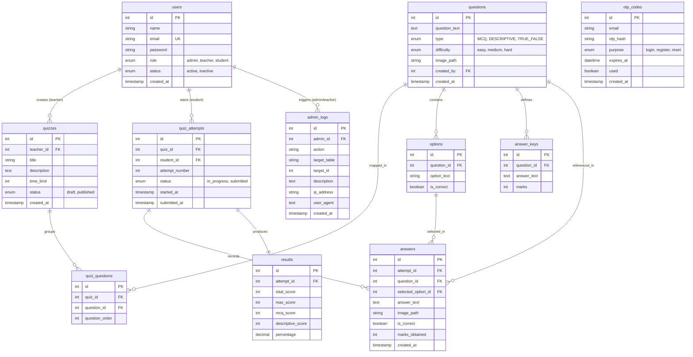

# Online Quiz and Exam System - Project Architecture & Database Design

This document provides a detailed overview of the system architecture, file hierarchy, database schema, entity relationships, and core workflow pipelines of the Online Quiz and Exam System.

---

## 1. System Architecture

The project is structured as a decoupled **MERN-like Stack** (using MySQL instead of MongoDB for relational data integrity) with a React Single Page Application (SPA) frontend and a Node.js/Express REST API backend.

```mermaid
graph TD
    subgraph Client Layer (React Frontend)
        SPA[React App / SPA]
        Ctx[Auth Context / State]
        Axios[Axios HTTP Client]
        SPA --> Ctx
        SPA --> Axios
    end

    subgraph API & Routing Layer (Node.js & Express)
        Router[Express Routing Middleware]
        AuthMW[Authentication / Role Authorization]
        Limiter[Rate Limiter & Helmet Security]
        Controllers[Feature Controllers]
        
        Axios <-->|HTTPS / JSON / CORS| Router
        Router --> Limiter
        Limiter --> AuthMW
        AuthMW --> Controllers
    end

    subgraph Business Logic & Utilities
        OCR[Tesseract.js OCR Engine]
        Sharp[Sharp Image Processor]
        Helpers[JWT & Bcrypt Utils]
        
        Controllers --> OCR
        Controllers --> Sharp
        Controllers --> Helpers
    end

    subgraph Database Layer (MySQL)
        Pool[mysql2 connection pool]
        DB[(MySQL Database)]
        
        Controllers <-->|Raw Parameterized SQL| Pool
        Pool <--> DB
    end
```

### Architectural Design Patterns
- **Decoupled Client-Server**: Communication is strictly API-driven via JSON.
- **Controller-Model Separation**: Controllers coordinate requests, validation, and responses. Models encapsulate database queries and schema abstractions.
- **Relational Integrity**: Uses MySQL's InnoDB storage engine to guarantee ACID transactions and physical constraints (Foreign Keys with cascade deletes).
- **OCR Processing Pipeline**: An advanced server-side image manipulation and text recognition pipeline using Sharp and Tesseract.js.

---

## 2. File Hierarchy

The repository is divided into two primary workspaces: `client` and `server`.

```
Quiz-System-MERN/
├── server/
│   ├── src/
│   │   ├── config/
│   │   │   ├── database.js          # DB Connection Pool Config
│   │   │   └── migrations.js        # SQL Schema Migrations Runner
│   │   ├── controllers/
│   │   │   ├── authController.js    # Auth & OTP Actions
│   │   │   ├── userController.js    # User Admin Actions
│   │   │   ├── quizController.js    # Quiz Management
│   │   │   ├── questionController.js# MCQ, True/False & Descriptive Questions
│   │   │   ├── resultController.js  # Result Submission & Stats
│   │   │   ├── descriptiveAnswerController.js # Descriptive Grading & Preset Criteria (Answer Keys)
│   │   │   └── ocrController.js     # Image Upload & OCR Processing
│   │   ├── middleware/
│   │   │   ├── auth.js              # Token Verification & Role Auth
│   │   │   └── upload.js            # Multer Multipart File Uploads
│   │   ├── models/                  # Raw SQL Model Classes
│   │   │   ├── User.js
│   │   │   ├── Quiz.js
│   │   │   ├── Question.js
│   │   │   ├── QuizAttempt.js       # New: Quiz Attempt Tracking
│   │   │   ├── Answer.js            # New: Unified Student Answers
│   │   │   ├── Result.js
│   │   │   ├── AnswerKey.js         # New: Preset Answer Keys
│   │   │   ├── OtpCode.js
│   │   │   └── AdminLog.js          # New: Audit Logs
│   │   ├── routes/                  # Express Express API Routers
│   │   ├── utils/
│   │   │   ├── helpers.js           # Password hash & Token utilities
│   │   │   └── ocrParser.js         # Parsing Questions & Options from Raw OCR Text
│   │   └── index.js                 # Express Application Bootstrapper
│   └── package.json
│
└── client/
    ├── src/
    │   ├── components/              # Shared Reusable Widgets
    │   │   ├── Navbar.jsx
    │   │   ├── Footer.jsx
    │   │   ├── ProtectedRoute.jsx
    │   │   ├── Alert.jsx
    │   │   ├── QuizTimer.jsx
    │   │   └── ExtractQuestionsFromImage.jsx # OCR Upload Dialog
    │   ├── context/
    │   │   └── AuthContext.jsx      # Global Authentication Store
    │   ├── hooks/                   # Custom Utility React Hooks
    │   ├── pages/                   # Major Screen Components
    │   │   ├── Home.jsx
    │   │   ├── Login.jsx
    │   │   ├── Register.jsx
    │   │   ├── AdminDashboard.jsx
    │   │   ├── TeacherDashboard.jsx
    │   │   ├── StudentDashboard.jsx
    │   │   ├── CreateQuiz.jsx
    │   │   ├── ManageQuestions.jsx  # Question CRUD & OCR Trigger
    │   │   ├── AttemptQuiz.jsx      # Real-time Quiz Interface
    │   │   ├── QuizResult.jsx       # Student Result Visualizer
    │   │   ├── QuizResults.jsx      # Teacher Results Overview
    │   │   └── GradeDescriptiveAnswers.jsx # Teacher Manual Grading
    │   ├── services/
    │   │   └── api.js               # Centralized Axios API Wrapper
    │   ├── styles/
    │   │   └── style.css            # Custom Styling System
    │   ├── App.jsx                  # React Router Configuration
    │   └── index.jsx                # DOM Root Mounter
    └── package.json
```

---

## 3. Database Schema & Relationships

The database is built on **MySQL** with the InnoDB engine to enforce integrity constraints. Below is the Entity-Relationship Diagram (ERD) mapping the tables and relations.

### 3.1. Entity Relationship Diagram (ERD)



---

### 3.2. Detailed Table Definitions

#### `users`
Stores all account details, credentials, and access roles.
- **Primary Key**: `id`
- **Unique Key**: `email`

| Column | Type | Nullable | Constraints / Defaults | Description |
| :--- | :--- | :--- | :--- | :--- |
| `id` | `INT` | No | `AUTO_INCREMENT` | Internal identifier |
| `name` | `VARCHAR(100)` | No | | User full name |
| `email` | `VARCHAR(100)` | No | `UNIQUE` | User email address |
| `password` | `VARCHAR(255)` | No | | BCRYPT hashed password |
| `role` | `ENUM` | No | `DEFAULT 'student'` | Allowed roles: `'admin'`, `'teacher'`, `'student'` |
| `status` | `ENUM` | No | `DEFAULT 'active'` | State: `'active'`, `'inactive'` |
| `created_at` | `TIMESTAMP` | Yes | `DEFAULT CURRENT_TIMESTAMP` | Account creation timestamp |

#### `quizzes`
Quizzes created by teachers. Supports publishing workflow.
- **Primary Key**: `id`
- **Foreign Key**: `teacher_id` references `users(id)` ON DELETE CASCADE

| Column | Type | Nullable | Constraints / Defaults | Description |
| :--- | :--- | :--- | :--- | :--- |
| `id` | `INT` | No | `AUTO_INCREMENT` | Internal identifier |
| `teacher_id` | `INT` | No | `FOREIGN KEY` | Creator ID (Teacher) |
| `title` | `VARCHAR(255)` | No | | Title of the quiz |
| `description` | `TEXT` | Yes | | Detail/instructions |
| `time_limit` | `INT` | No | `DEFAULT 10` | Duration in minutes |
| `status` | `ENUM` | No | `DEFAULT 'draft'` | State: `'draft'`, `'published'` |
| `created_at` | `TIMESTAMP` | Yes | `DEFAULT CURRENT_TIMESTAMP` | Quiz setup timestamp |

#### `questions`
Contains individual questions, detached from specific quizzes for maximum reusability.
- **Primary Key**: `id`
- **Foreign Key**: `created_by` references `users(id)` ON DELETE SET NULL

| Column | Type | Nullable | Constraints / Defaults | Description |
| :--- | :--- | :--- | :--- | :--- |
| `id` | `INT` | No | `AUTO_INCREMENT` | Internal identifier |
| `question_text` | `TEXT` | No | | Body of the question |
| `type` | `ENUM` | No | `DEFAULT 'MCQ'` | Type: `'MCQ'`, `'DESCRIPTIVE'`, `'TRUE_FALSE'` |
| `difficulty` | `ENUM` | No | `DEFAULT 'medium'` | Grade level: `'easy'`, `'medium'`, `'hard'` |
| `image_path` | `VARCHAR(255)` | Yes | | Optional reference image |
| `created_by` | `INT` | Yes | `FOREIGN KEY` | Creator user ID |
| `created_at` | `TIMESTAMP` | Yes | `DEFAULT CURRENT_TIMESTAMP` | Setup timestamp |

#### `quiz_questions`
Junction table linking questions to quizzes in a specific ordering.
- **Primary Key**: `id`
- **Foreign Keys**:
  - `quiz_id` references `quizzes(id)` ON DELETE CASCADE
  - `question_id` references `questions(id)` ON DELETE CASCADE
- **Unique Constraint**: `(quiz_id, question_id)` — Prevents duplicate mapping.

| Column | Type | Nullable | Constraints / Defaults | Description |
| :--- | :--- | :--- | :--- | :--- |
| `id` | `INT` | No | `AUTO_INCREMENT` | Internal identifier |
| `quiz_id` | `INT` | No | `FOREIGN KEY` | Linked quiz |
| `question_id` | `INT` | No | `FOREIGN KEY` | Linked question |
| `question_order`| `INT` | No | `DEFAULT 1` | Position order in the quiz |

#### `options`
Normalized MCQ / True-False choices.
- **Primary Key**: `id`
- **Foreign Key**: `question_id` references `questions(id)` ON DELETE CASCADE

| Column | Type | Nullable | Constraints / Defaults | Description |
| :--- | :--- | :--- | :--- | :--- |
| `id` | `INT` | No | `AUTO_INCREMENT` | Internal identifier |
| `question_id` | `INT` | No | `FOREIGN KEY` | Question reference |
| `option_text` | `VARCHAR(255)` | No | | Option description |
| `is_correct` | `BOOLEAN` | No | `DEFAULT FALSE` | Correctness flag |

#### `quiz_attempts`
Records students' attempts and started/submitted timestamps.
- **Primary Key**: `id`
- **Foreign Keys**:
  - `quiz_id` references `quizzes(id)` ON DELETE CASCADE
  - `student_id` references `users(id)` ON DELETE CASCADE

| Column | Type | Nullable | Constraints / Defaults | Description |
| :--- | :--- | :--- | :--- | :--- |
| `id` | `INT` | No | `AUTO_INCREMENT` | Internal identifier |
| `quiz_id` | `INT` | No | `FOREIGN KEY` | Attempted Quiz |
| `student_id` | `INT` | No | `FOREIGN KEY` | Attempting Student |
| `attempt_number`| `INT` | No | `DEFAULT 1` | Incremental try number |
| `status` | `ENUM` | No | `DEFAULT 'in_progress'` | Attempt status: `'in_progress'`, `'submitted'` |
| `started_at` | `TIMESTAMP` | Yes | `DEFAULT CURRENT_TIMESTAMP` | Start time |
| `submitted_at` | `TIMESTAMP` | Yes | | Completion time |

#### `answers`
Unified student answers record for both option selections (MCQ/True-False) and written text/images (Descriptive).
- **Primary Key**: `id`
- **Foreign Keys**:
  - `attempt_id` references `quiz_attempts(id)` ON DELETE CASCADE
  - `question_id` references `questions(id)` ON DELETE CASCADE
  - `selected_option_id` references `options(id)` ON DELETE SET NULL
- **Unique Constraint**: `(attempt_id, question_id)` — Restricts one answer per question per attempt.

| Column | Type | Nullable | Constraints / Defaults | Description |
| :--- | :--- | :--- | :--- | :--- |
| `id` | `INT` | No | `AUTO_INCREMENT` | Internal identifier |
| `attempt_id` | `INT` | No | `FOREIGN KEY` | Associated attempt |
| `question_id` | `INT` | No | `FOREIGN KEY` | Question reference |
| `selected_option_id`| `INT` | Yes | `FOREIGN KEY` | Option selected (MCQ/True-False) |
| `answer_text` | `TEXT` | Yes | | Written response (Descriptive) |
| `image_path` | `VARCHAR(255)` | Yes | | Student uploaded solution workspace image |
| `is_correct` | `BOOLEAN` | Yes | `NULL` | Scoring evaluation flag |
| `marks_obtained`| `INT` | No | `DEFAULT 0` | Awarded marks |
| `created_at` | `TIMESTAMP` | Yes | `DEFAULT CURRENT_TIMESTAMP` | Submission timestamp |

#### `results`
Aggregated final score values compiled from attempts.
- **Primary Key**: `id`
- **Foreign Key**: `attempt_id` references `quiz_attempts(id)` ON DELETE CASCADE

| Column | Type | Nullable | Constraints / Defaults | Description |
| :--- | :--- | :--- | :--- | :--- |
| `id` | `INT` | No | `AUTO_INCREMENT` | Internal identifier |
| `attempt_id` | `INT` | No | `FOREIGN KEY` | Associated attempt |
| `total_score` | `INT` | No | `DEFAULT 0` | Aggregated points |
| `max_score` | `INT` | No | `DEFAULT 0` | Max possible points |
| `mcq_score` | `INT` | No | `DEFAULT 0` | Auto-graded MCQ score |
| `descriptive_score`| `INT` | No | `DEFAULT 0` | Graded Descriptive score |
| `percentage` | `DECIMAL(5,2)` | Yes | | Calculated percentage |

#### `answer_keys`
Teacher-defined grading keys and rubrics for descriptive questions.
- **Primary Key**: `id`
- **Foreign Key**: `question_id` references `questions(id)` ON DELETE CASCADE

| Column | Type | Nullable | Constraints / Defaults | Description |
| :--- | :--- | :--- | :--- | :--- |
| `id` | `INT` | No | `AUTO_INCREMENT` | Internal identifier |
| `question_id` | `INT` | No | `FOREIGN KEY` | Descriptive question reference |
| `answer_text` | `TEXT` | No | | Correct response rubric text |
| `marks` | `INT` | No | `DEFAULT 0` | Grading value weights |

#### `otp_codes`
Authenticating check logs.
- **Primary Key**: `id`

| Column | Type | Nullable | Constraints / Defaults | Description |
| :--- | :--- | :--- | :--- | :--- |
| `id` | `INT` | No | `AUTO_INCREMENT` | Internal identifier |
| `email` | `VARCHAR(100)` | No | | Target email |
| `otp_hash` | `VARCHAR(255)` | No | | Hash of OTP token |
| `purpose` | `ENUM` | No | `DEFAULT 'login'` | Purposes: `'login'`, `'register'`, `'reset'` |
| `expires_at` | `DATETIME` | No | | Expiration limit |
| `used` | `BOOLEAN` | No | `DEFAULT FALSE` | Used status check |
| `created_at` | `TIMESTAMP` | Yes | `DEFAULT CURRENT_TIMESTAMP` | Creation time |

#### `admin_logs`
Tracks admin/teacher operations.
- **Primary Key**: `id`
- **Foreign Key**: `admin_id` references `users(id)` ON DELETE CASCADE

| Column | Type | Nullable | Constraints / Defaults | Description |
| :--- | :--- | :--- | :--- | :--- |
| `id` | `INT` | No | `AUTO_INCREMENT` | Internal identifier |
| `admin_id` | `INT` | No | `FOREIGN KEY` | Creator profile |
| `action` | `VARCHAR(100)` | No | | Operational task name |
| `target_table` | `VARCHAR(100)` | Yes | | Affected schema table |
| `target_id` | `INT` | Yes | | Affected profile ID |
| `description` | `TEXT` | Yes | | Description details |
| `ip_address` | `VARCHAR(45)` | Yes | | IP address |
| `user_agent` | `TEXT` | Yes | | Browser metadata |
| `created_at` | `TIMESTAMP` | Yes | `DEFAULT CURRENT_TIMESTAMP` | Operation timestamp |

---

## 4. Key Subsystems & Workflows

### 4.1. Authentication & Security
- **Registration & Login**: Secure account setup. Passwords are encrypted utilizing `bcryptjs` (salt factor 10) before storage. Authentication tokens are issued as JSON Web Tokens (JWT) signed with a configured `JWT_SECRET`, valid for 7 days.
- **Role Control**: Express route middleware validates claims. `authenticate` unpacks JWT and sets `req.user`. `authorize(['teacher', 'admin'])` restricts route execution based on user credentials.
- **OTP Verification**: Verifies email legitimacy. Generates short-lived codes, hashes them, and checks expiration in the `otp_codes` table prior to granting access or password updates.

### 4.2. Quiz Attempting & Scoring Lifecycle
1. **Enrollment & Check**: Students log in and open `AttemptQuiz.jsx`. The client checks attempt status via `GET /api/results/check/:quizId` to ensure the student has not already completed it.
2. **Timer & Submission**: A timer counts down. Upon submission or timer expiry, MCQ inputs are compiled into a key-value object (`{ [questionId]: selectedOptionId }`).
3. **MCQ Auto-Grading**: `POST /api/results/submit` handles the submission transactionally:
   - Validates submission status.
   - Fetches questions from database.
   - Computes correct choices (scores 1 point per correct option) and logs selection in `answers`.
   - Inserts results record in `results` table.
4. **Descriptive Answer Storage**: If a quiz contains descriptive questions, students submit their answers (and optional supporting images) using the `answerAPI.submitAnswer` wrapper. Submissions go to `answers` where they remain as `is_correct IS NULL`.
5. **Teacher Evaluation**: Teachers load ungraded answers, comparing student responses against criteria defined in `answer_keys`. Submitting grades updates `answers` with `marks_obtained`, feedback details, and flags `is_correct`. It then aggregates and updates `results` with descriptive scores.

### 4.3. OCR Question Extraction Pipeline
A key tool for teachers to import questions in bulk from images of exam papers.

```
+------------------+     Multipart Upload     +----------------------+
| Upload interface | -----------------------> | sharp preprocessing  |
| (Component:      |                          | (convert grayscale,  |
| ExtractQuestions) |                          | contrast, normalise) |
+------------------+                          +----------------------+
                                                         |
                                                         v
+------------------+     Regex Match Parse    +----------------------+
| JSON questions   | <----------------------- | Tesseract OCR        |
| preview/editor   |                          | (Eng text extraction)|
+------------------+                          +----------------------+
         |
         | Save Questions
         v
+------------------+
| API bulk insert  |
| to DB            |
+------------------+
```

1. **Upload & Preprocessing**: Images are uploaded to `POST /api/ocr/extract-questions`. The backend routes the file through `sharp` (converts to grayscale, normalizes histogram, enhances contrast) to produce an optimized PNG file for extraction.
2. **Text Extraction**: Tesseract OCR runs on the processed image, generating a raw text block. The raw image is deleted from filesystem once extraction is complete.
3. **Structured Parser**: The `ocrParser.js` parses the text block line by line:
   - **Questions**: Detects regex prefix `Q[0-9].`, `Q.[0-9]`, or `[0-9].`.
   - **Options**: Identifies options using matching patterns: `(A)`, `a)`, `1)`, etc.
   - **Marks**: Detects values matching `(\d+)\s*(marks|points|pts)`.
4. **Interactive Editor**: The structured JSON payload is returned to the teacher in a modal editor where they can refine texts, adjust option configurations, assign correct answer markers, and execute bulk inserts.

---

## 5. API Reference Summary

| Method | Endpoint | Access Control | Description |
| :--- | :--- | :--- | :--- |
| **POST** | `/api/auth/register` | Public | Register student/teacher account |
| **POST** | `/api/auth/login` | Public | Account authentication |
| **POST** | `/api/auth/otp/request` | Public | Request OTP email check |
| **POST** | `/api/auth/otp/verify` | Public | Validation check on OTP |
| **GET** | `/api/auth/me` | Authenticated | Retrieve current user status |
| **GET** | `/api/users` | Admin Only | Get listing of all registered users |
| **PATCH**| `/api/users/:id/status`| Admin Only | Toggle user status (active/inactive) |
| **DELETE**| `/api/users/:id` | Admin Only | Delete user profile |
| **POST** | `/api/quizzes` | Teacher Only | Setup new Quiz instance |
| **GET** | `/api/quizzes/all` | Authenticated | Retrieve listing of all quizzes |
| **GET** | `/api/quizzes/teacher/my-quizzes` | Teacher Only | List teacher's owned quizzes |
| **GET** | `/api/quizzes/:id` | Authenticated | Details of specific quiz |
| **PATCH**| `/api/quizzes/:id` | Teacher Only | Modify quiz details |
| **DELETE**| `/api/quizzes/:id` | Teacher Only | Remove quiz and cascade dependencies |
| **POST** | `/api/questions/mcq` | Teacher Only | Add MCQ / True-False (supports file upload) |
| **POST** | `/api/questions/descriptive` | Teacher Only | Add Descriptive (supports file upload) |
| **GET** | `/api/questions/:quizId` | Authenticated | Retrieve quiz questions (omits answers for students) |
| **POST** | `/api/answers/submit` | Student Only | Submit descriptive answers |
| **PATCH**| `/api/answers/grade/:answerId` | Teacher Only | Grade a descriptive student response |
| **POST** | `/api/answers/preset` | Teacher Only | Setup grading criteria key |
| **POST** | `/api/results/submit` | Student Only | Process MCQ/True-False responses & issue results |
| **GET** | `/api/results/:id` | Authenticated | Fetch result attempt breakdown & stats |
| **POST** | `/api/ocr/extract-questions` | Teacher Only | Upload question paper & run OCR |
| **POST** | `/api/ocr/validate-questions` | Teacher Only | Validation checks on extracted questions |
